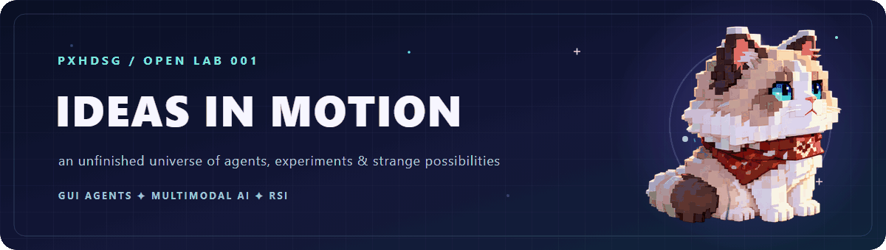
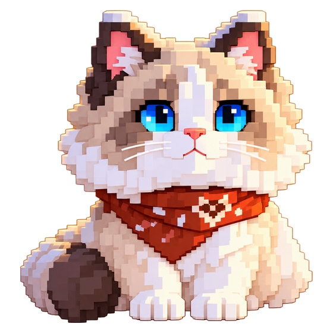
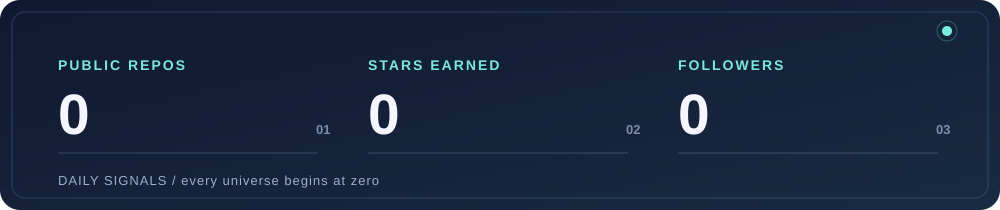

  

  

# 欢迎来到「未完成宇宙」

这里收集那些还没有标准答案的念头：会读懂屏幕的智能体，能把视觉与语言接在一起的模型，还有会反过来改进自己的 AI 系统。

有些念头会长成论文，有些会变成能运行的工具；也有些只留下一个足够好的问题。这个仓库会记录它们从灵光一现到反复试验的过程。

  
   
  入口管理员：从头像里的雪原跑来，负责巡视灵感

## 这座实验场会长出什么？

**01 / 研究手记**　把一个模糊的问题拆成可以追问、可以验证的假设。  
**02 / 可运行原型**　让纸上的想法真正去观察、推理和行动。  
**03 / 诚实的复盘**　记录惊喜，也记录失灵、误判和下一次尝试。

## 正在追踪的三颗星

| 坐标 | 正在好奇 |
| :--- | :--- |
| **GUI Agents** | 智能体怎样理解界面，并在真实操作中保持可靠？ |
| **Multimodal AI** | 视觉、语言和行动怎样真正协同？ |
| **Recursive Self-Improvement** | 系统怎样在反馈中持续改进，又怎样证明自己真的进步了？ |

## 每日信号

  

## 贡献轨迹

  

## 给路过的人

今天是一张空白地图。以后每个项目都会留下一条路径：问题从哪来，尝试了什么，哪里走错，又因为什么继续向前。

如果你也在追逐这些问题，欢迎在 [Issues](https://github.com/pxhdsg/pxhdsg/issues) 留下一颗新的星。
